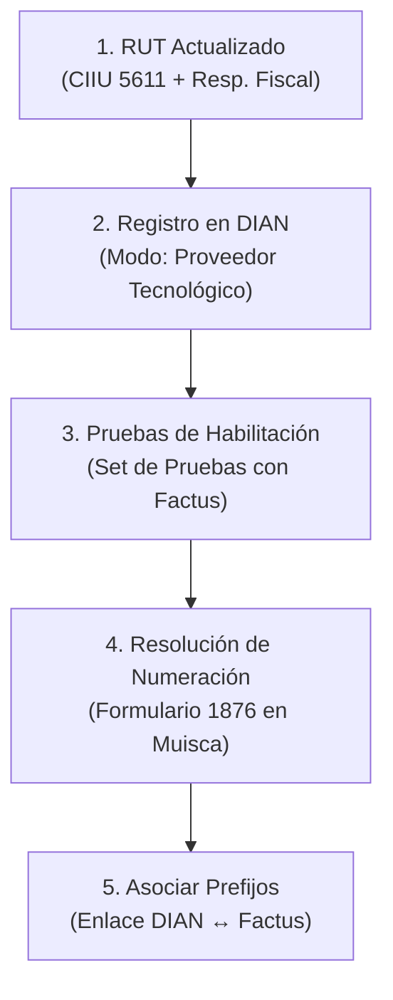
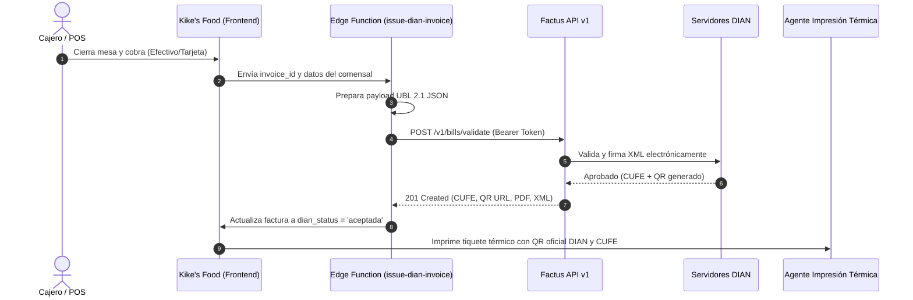

# 📜 Guía Paso a Paso: Facturación Electrónica DIAN e Integración con Factus en Kike's Food

Esta guía detalla el proceso legal, tributario y técnico para emitir **Factura Electrónica de Venta (FEV)** y **Documento Equivalente Electrónico POS** en Colombia cumpliendo con el Estatuto Tributario, la Resolución DIAN 000165 de 2023 y la integración con la API de **Factus**.

---

## 🏛️ PARTE 1: Ruta de Gestión Legal y Tributaria ante la DIAN

Este proceso lo realiza cada dueño de restaurante (o tú en su representación) ante la Dirección de Impuestos y Aduanas Nacionales (DIAN).



---

### Paso 1: Verificación del RUT del Restaurante
El restaurante (Persona Natural o Jurídica) debe contar con su Registro Único Tributario (RUT) al día con:
1. **Actividad Económica:** CIIU **5611** *(Expendio a la mesa de comidas preparadas)* o **5613** *(Expendio de comidas preparadas en cafeterías)*.
2. **Responsabilidades Tributarias:**
   - **`33` - Impuesto Nacional al Consumo (INC):** La gran mayoría de restaurantes y bares en Colombia pertenecen al régimen de INC (tarifa del **8%**).
   - **`48` - Impuesto sobre las Ventas (IVA):** Aplica si el restaurante opera bajo franquicia, contrato de concesión o exportación (tarifa general del **19%**).
   - **`47` - Régimen Simple de Tributación (RST):** Si el restaurante se acogió a las tarifas unificadas del Régimen Simple.
3. **Correo Electrónico Válido:** Es el canal donde la DIAN envía los tokens de acceso directo.

---

### Paso 2: Registro en el Portal de Factura Electrónica de la DIAN
1. Ingresar a [dian.gov.co](https://www.dian.gov.co) > sección **Temas de Interés** > **Facturando Electrónicamente**.
2. Seleccionar *Persona* o *Empresa* e ingresar con los datos del representante legal.
3. La DIAN enviará un enlace de acceso temporal al correo registrado en el RUT.
4. En el menú lateral, ir a **Registro y Habilitación** > **Documentos Electrónicos** > **Factura Electrónica**.
5. En la opción *Configurar Modos de Operación*:
   - Tipo de software: **A través de un Proveedor Tecnológico**.
   - Nombre de la empresa proveedora: Seleccionar **FACTUS TECH S.A.S.** (o el aliado tecnológico asignado por Factus).
   - Nombre del software: Seleccionar el software provisto por Factus.

---

### Paso 3: Set de Pruebas de Habilitación
1. La DIAN asignará un **TestSetId** (identificador único del set de pruebas).
2. Se ingresa a la plataforma de Factus (entorno Sandbox / Habilitación) y se vincula el `TestSetId`.
3. Factus emite automáticamente un paquete de pruebas (habitualmente 8 facturas electrónicas, 1 nota débito y 1 nota crédito con diferentes tipos de impuestos y medios de pago).
4. Una vez la DIAN valide que todos los documentos de prueba fueron aprobados, el estado del restaurante en la DIAN cambiará automáticamente a **"HABILITADO"**.

---

### Paso 4: Solicitud de Resolución de Numeración (Formulario 1876)
Una vez habilitado, el restaurante debe solicitar la autorización de rangos de numeración para producción:
1. Ingresar al portal transaccional **Muisca** de la DIAN con usuario y contraseña.
2. Ir a **Numeración de Facturación** > **Solicitar Numeración de Facturación**.
3. Seleccionar la modalidad: **Factura Electrónica de Venta**.
4. Definir:
   - **Prefijo:** Entre 1 y 4 letras mayúsculas (ejemplo: `FE`, `KF`, `POS`).
   - **Rango:** Desde `1` hasta `5000` (o la cantidad estimada de comandas para 12 meses).
5. Firmar digitalmente con el instrumento de firma electrónica de la DIAN.
6. La DIAN generará el documento oficial **Formulario 1876** con:
   - Número de Resolución.
   - Fecha de Expedición y Vigencia (normalmente 12 o 18 meses).
   - Prefijo y Rango autorizado.
   - **Clave Técnica** (cadena alfanumérica necesaria para firmar los XML).

---

### Paso 5: Asociar Prefijos en el Portal de la DIAN
1. Regresar a **Facturando Electrónicamente** > **Configuración** > **Asociar Prefijos**.
2. Seleccionar el proveedor tecnológico **Factus** y elegir el prefijo recién autorizado en el Paso 4.
3. Hacer clic en **Agregar**. Desde este momento, Factus queda legalmente autorizado por la DIAN para firmar y emitir facturas con ese prefijo.

---

## 💻 PARTE 2: Ruta Técnica de Integración con Factus en Kike's Food

El backend de Kike's Food ya cuenta con las tablas preparadas (`billing_settings`, `invoice_sequences`, `invoices` con `cufe` y `dian_status`).



---

### Paso T1: Credenciales de Factus API
En el panel de desarrollador de Factus (`api.factus.com.co`):
1. Obtener:
   - **`FACTUS_CLIENT_ID`**
   - **`FACTUS_CLIENT_SECRET`**
   - **`FACTUS_API_URL`** (`https://api-sandbox.factus.com.co` para pruebas o `https://api.factus.com.co` para producción).
2. Guardar estas credenciales como secretos seguros en Supabase:
   ```bash
   npx supabase secrets set FACTUS_CLIENT_ID="tu_client_id"
   npx supabase secrets set FACTUS_CLIENT_SECRET="tu_client_secret"
   ```

---

### Paso T2: Edge Function de Emisión (`issue-dian-invoice`)
Para no exponer credenciales secretas en el frontend, se crea una Edge Function en Supabase: `supabase/functions/issue-dian-invoice/index.ts`.

#### 1. Mapeo de Medios de Pago DIAN:
En Colombia la DIAN exige códigos específicos:
- **Efectivo:** Código `10`
- **Tarjeta Débito:** Código `49`
- **Tarjeta Crédito:** Código `48`
- **Transferencia (Nequi / Daviplata / Bancolombia):** Código `31` o `47`

#### 2. Manejo de Consumidor Final:
Si el cliente no desea factura electrónica a su nombre (muy común en restaurantes de comida rápida):
```json
{
  "identification": "222222222222",
  "dv": null,
  "identification_document_id": 13, // Cédula de Ciudadanía
  "names": "CONSUMIDOR FINAL",
  "company": "",
  "trade_name": "",
  "email": "consumidorfinal@restaurante.com"
}
```

#### 3. Estructura del Payload enviado a Factus:
```typescript
const payload = {
  numbering_range_id: tenantSettings.factus_range_id, // ID del rango en Factus
  reference_code: invoice.full_number, // ej. "FE-1042"
  observation: "Consumo en mesa " + invoice.table_label,
  payment_method_code: mapPaymentMethod(invoice.payment_method),
  customer: {
    identification: invoice.customer.identification || "222222222222",
    identification_document_id: invoice.customer.doc_type === "NIT" ? 6 : 13,
    names: invoice.customer.name || "CONSUMIDOR FINAL",
    email: invoice.customer.email || tenant.email,
    phone: invoice.customer.phone || tenant.phone
  },
  items: invoice.items.map((item) => ({
    code_reference: item.productId,
    name: item.name,
    quantity: item.quantity,
    discount_rate: 0,
    price: item.unitPrice, // Precio antes de impuestos
    tax_rate: invoice.tax_rate, // 8.00 (INC) o 19.00 (IVA)
    unit_measure_id: 70, // Código 70 = Unidad estándar DIAN
    standard_code_id: 1, // UNSPSC estándar
    is_excluded: invoice.tax_type === 'NINGUNO' ? 1 : 0
  }))
};
```

#### 4. Respuesta y Actualización en la Base de Datos:
Factus devuelve el documento validado:
```json
{
  "status": "Created",
  "message": "Factura validada con éxito",
  "data": {
    "bill": {
      "id": 12845,
      "number": "FE-1042",
      "cufe": "9f32b1a8c904e2874bc10...",
      "qr": "https://catalogo-vpfe.dian.gov.co/document/searchqr?documentkey=9f32b1a8...",
      "status": 1,
      "xml_url": "https://storage.factus.com.co/xml/...",
      "pdf_url": "https://storage.factus.com.co/pdf/..."
    }
  }
}
```

La función ejecuta en Supabase:
```sql
update public.invoices
set cufe = '9f32b1a8c904e2874bc10...',
    dian_status = 'aceptada'
where id = 'uuid-de-la-factura';
```

---

### Paso T3: Impresión del Tiquete Térmico con QR DIAN
El agente de impresión local de Kike's Food (`impresora/lib/plantillas.mjs`) ya está preparado para imprimir:
1. Encabezado con NIT, Razón Social y Número de Resolución DIAN del Formulario 1876.
2. Prefijo y Consecutivo (`FE-1042`).
3. Desglose de Base Gravable e Impuesto (INC 8% o IVA 19%) y Propina voluntaria.
4. **Código QR nativo ESC/POS** que apunta a la URL oficial de la DIAN (`catalogo-vpfe.dian.gov.co`).
5. Cadena visible del **CUFE** abreviada.

---

## ⏱️ Cronograma Estimado de Implementación

| Fase | Tarea | Tiempo Estimado | Responsable |
| :--- | :--- | :---: | :---: |
| **Fase 1: Trámite DIAN** | Solicitud de RUT, habilitación en portal DIAN y set de pruebas | 2 a 4 días hábiles | Dueño del Restaurante / Contador |
| **Fase 2: Numeración** | Formulario 1876 de la DIAN y asociación de prefijo con Factus | 1 día hábil | Dueño del Restaurante / DIAN |
| **Fase 3: Edge Function** | Despliegue de función `issue-dian-invoice` en Supabase | 2 a 3 horas | Equipo Técnico Kike's Food |
| **Fase 4: Pruebas Piloto** | Emisión de 5 facturas en Sandbox y verificación de QR impreso | 1 hora | Soporte Kike's Food + Restaurante |
