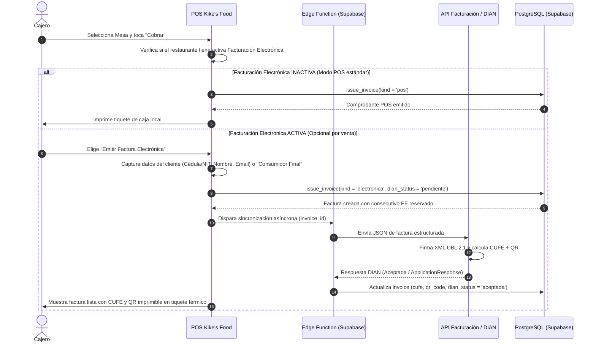

# Instructivo Técnico: Arquitectura e Implementación de Facturación Electrónica DIAN en Kike's Food

> **Filosofía del Módulo:** La facturación electrónica en Kike's Food es **100% opcional y desacoplada**. Los restaurantes operan por defecto con comandas de cocina y tiquete POS interno de caja. Solo aquellos restaurantes que activen el switch *"Facturación Electrónica DIAN"* y configuren su resolución autorizada activan el pipeline de validación previa ante la DIAN.

---

## 1. Modelo de Datos Existente en Kike's Food

El esquema de base de datos en Supabase ya cuenta con las tablas base preparadas para la normativa UBL 2.1 de la DIAN:

### 1.1 `public.billing_settings` (Configuración del Restaurante)
Almacena los parámetros técnicos del emisor:
```sql
- tenant_id: uuid (PK, FK tenants)
- software_id: text (ID asignado en el portal DIAN)
- pin: text (PIN de 5 dígitos del software)
- technical_key: text (Clave técnica generada por la DIAN al asociar el prefijo)
- certificate_vault_id: text (Referencia al certificado digital)
- environment: text ('habilitacion' | 'produccion')
```

### 1.2 `public.invoice_sequences` (Rangos y Resoluciones de la DIAN)
Controla la numeración consecutiva autorizada mediante el Formulario 1876:
```sql
- tenant_id: uuid
- kind: text ('pos' | 'electronica')
- prefix: text (ej. 'FE', 'FAC')
- next_number: integer (consecutivo actual, protegido por trigger clamp)
- range_from: integer (número inicial autorizado)
- range_to: integer (número final autorizado)
- resolution_number: text (número de resolución DIAN)
- resolution_date: date (fecha de expedición)
- valid_until: date (fecha de vencimiento del rango, ej. 12 o 24 meses)
```

### 1.3 `public.invoices` (Facturas Emitidas y Validables)
Contiene la información fiscal consolidada con desglose de INC/IVA y propina:
```sql
- id: uuid
- tenant_id: uuid
- order_id: bigint
- kind: text ('pos' | 'electronica')
- prefix: text
- number: integer
- full_number: text (ej. 'FE-1045')
- customer: jsonb ({ "docType", "docNumber", "name", "email", "phone", "address" })
- payment_method: text ('efectivo' | 'tarjeta' | 'transferencia')
- items: jsonb (detalle de platos, modificadores, bases y precios)
- items_total: integer (total de consumo con impuesto incluido)
- tax_base: integer (base gravable neta)
- tax_type: text ('INC' al 8% o 'IVA' al 19%)
- tax_rate: numeric(5,2)
- tax: integer (valor liquidado del impuesto)
- tip: integer (propina voluntaria - NO gravable)
- total: integer (consumo + impuesto + propina)
- cufe: text (Código Único de Facturación Electrónica generado)
- dian_status: text ('no_aplica' | 'simulado' | 'pendiente' | 'aceptada' | 'rechazada')
```

---

## 2. Estrategia de Conexión: ¿Software Propio vs Proveedor Tecnológico (PT)?

Para una aplicación SaaS multi-inquilino (multi-tenant) como Kike's Food, existen dos caminos técnicos:

```
[Opción A: Conexión Directa SOAP/XML a la DIAN]
Kike's Food Backend ---> Construcción XML UBL 2.1 ---> Firma XAdES-BES local ---> WebService SOAP DIAN
Desventaja: Requiere comprar certificado digital .p12 para KGroup o cada cliente, actualizar esquemas UBL manualmente en cada cambio normativo de la DIAN y gestionar servidores de correo SMTP masivo para los adquirentes.

[Opción B: Integración vía API de Facturación / Proveedor Tecnológico (RECOMENDADA)]
Kike's Food (JSON) ---> REST API (Factus / Alegra API / Dianbox / Siigo) ---> DIAN Validación Previa
Ventaja: 
- El proveedor tecnológico absorbe la firma digital, validación de esquemas XML, reintentos y envío del correo al cliente.
- Kike's Food solo envía un payload JSON limpio con los ítems de la mesa.
- Activación plug-and-play por restaurante mediante API Token.
```

---

## 3. Flujo Operativo en Caja (Paso a Paso)



---

## 4. Requisitos de la Representación Gráfica (Tiquete Térmico y PDF)

Según la Resolución 000042 de 2020 y 000165 de 2023 de la DIAN, el tiquete o factura debe contener obligatoriamente:

1. **Datos del Emisor:**
   - Nombre o Razón Social del restaurante.
   - NIT y tipo de régimen (Responsable de INC / IVA).
   - Dirección y ciudad del establecimiento.
2. **Datos de la Factura:**
   - Denominación expresa: *"Factura Electrónica de Venta"*.
   - Prefijo y Consecutivo autorizado (ej. `FE-1250`).
   - Número de Resolución DIAN, fecha de vigencia y rango autorizado.
3. **Desglose Económico Estricto:**
   - Subtotal gravable.
   - Impuesto Nacional al Consumo (INC 8%) o IVA (19%) discriminado **por separado** (no refundido).
   - Propina voluntaria claramente diferenciada (la propina no forma parte de la base gravable).
   - Total a pagar y método de pago (Efectivo, Tarjeta, Transferencia).
4. **Elementos Criptográficos DIAN:**
   - **CUFE (Código Único de Facturación Electrónica):** Cadena alfanumérica de 96 caracteres en texto visible o enlace.
   - **Código QR:** Código bidimensional cuadrado que codifica los datos clave de la factura y apunta a la URL de consulta pública en el portal DIAN:
     `https://catalogo-vpfe.dian.gov.co/document/searchqr?documentkey=<CUFE>`

---

## 5. Manejo de Fallos y Contingencia

Si el servicio de la DIAN o del proveedor se encuentra caído o sin respuesta al momento de cerrar una mesa en el restaurante:

1. **Garantía de Servicio en Sala:** El cobro y la atención de la mesa **nunca se detienen**. La comanda se cobra en caja con estado `dian_status = 'pendiente'`.
2. **Cola de Reintentos (Background Retry):** Un trabajo en cola reintenta la transmisión en segundo plano una vez se restablezca la conectividad.
3. **Contingencia DIAN (Tipo 4):** Si la DIAN emite comunicado de caída de sus servidores, el restaurante puede expedir la factura bajo el prefijo de contingencia y tiene un plazo de hasta 48 horas posteriores al restablecimiento del servicio para transmitir los comprobantes acumulados.
